<!-- .slide: class="title-slide" -->

<p class="kicker">СДП 2026/27 · Семинар 7 · 19 ноември</p>

# Proxy, стек и опашка

Нови интерфейси върху стари структури — и обект, който се преструва на референция

<p class="small">Записки: <a href="notes.md">notes.md</a> · Задачи: <a href="exercises.md">exercises.md</a></p>

---

## План за днес

| Време | Какво правим |
|---|---|
| 10 мин | Загрявка: двусвързан списък и итератори |
| 15 мин | Преговор: стек, опашка, дек, адаптери, кръгов буфер |
| 20 мин | На живо: Proxy — `BitVector`, чийто `[]` връща прокси |
| ☕ | почивка |
| 35 мин | Практика: `Stack`, `RingQueue`, два стека, `BitVector`, приложения |
| 10 мин | Разбор, контролно 1 и какво следва |

---

## Загрявка

1. Защо `insert` в двусвързан списък с фиктивен възел няма специални случаи? <span class="fragment answer">всеки истински възел винаги има истински prev и next</span>
2. Какво е `*end()`? <span class="fragment answer">недефинирано поведение</span>
3. Защо `std::sort` не работи със `std::list`? <span class="fragment answer">иска random access итератор</span>
4. ASan казва „Indirect leak“. Какво значи? <span class="fragment answer">блокът е достижим само през друг изтекъл блок</span>

---

<!-- .slide: data-background-color="#e3eefb" -->

# Преговор

<p class="small">15 минути · стек, опашка, дек, адаптери</p>

---

## LIFO и FIFO

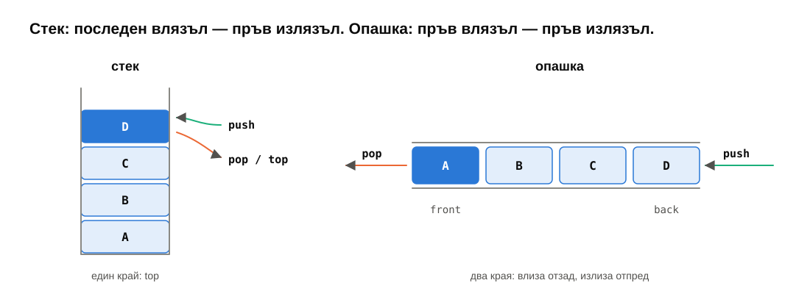

<p class="small">Всички операции са $\Theta(1)$ — затова интерфейсът <strong>забранява</strong> всичко останало: индекс, обхождане, вмъкване в средата.</p>

---

## Стекът, който ползвате всеки ден

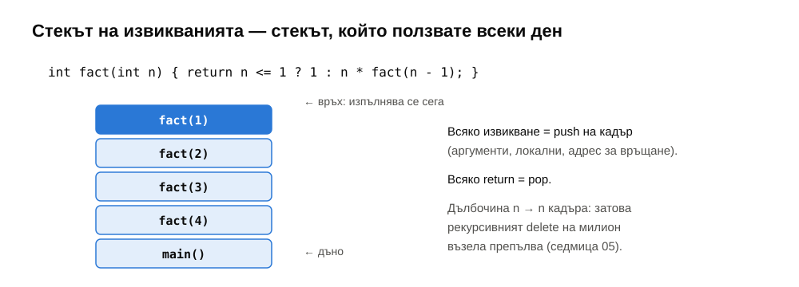

<p class="small fragment">Всяка рекурсия може да се пренапише с <strong>явен</strong> стек — ще го правим за дървета (седмица 09) и графи (седмица 13).</p>

---

## Адаптер: стекът скрива останалото

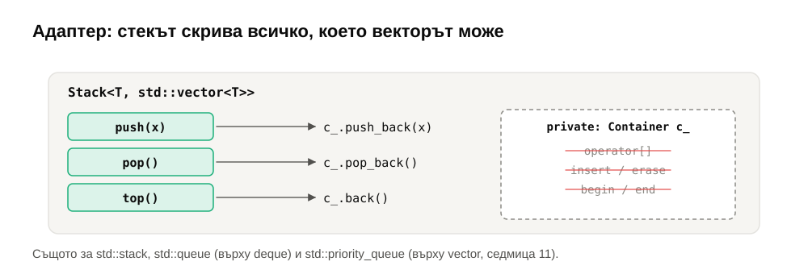

---

## Адаптерите в STL

| Адаптер | Иска от контейнера | По подразбиране |
|---|---|---|
| `std::stack` | `back`, `push_back`, `pop_back` | `std::deque` |
| `std::queue` | `front`, `back`, `push_back`, `pop_front` | `std::deque` |
| `std::priority_queue` | `front`, `push_back`, `pop_back` + random access | `std::vector` |

Защо `std::queue` върху `std::vector` не става? <span class="fragment answer">векторът няма <code>pop_front</code> — нарочно: би бил $\Theta(n)$</span>

---

## Реализации на опашка

| Реализация | `push` | `pop` |
|---|---|---|
| вектор с `erase(begin())` | $\Theta(1)$ аморт. | **$\Theta(n)$** |
| списък с `tail_` | $\Theta(1)$ | $\Theta(1)$ |
| кръгов буфер | $\Theta(1)$ аморт. | $\Theta(1)$ |
| два стека (върху вектори) | $\Theta(1)$ аморт. | $\Theta(1)$ аморт. |
| `std::deque` | $\Theta(1)$ | $\Theta(1)$ |

---

## Дек: масив от блокове

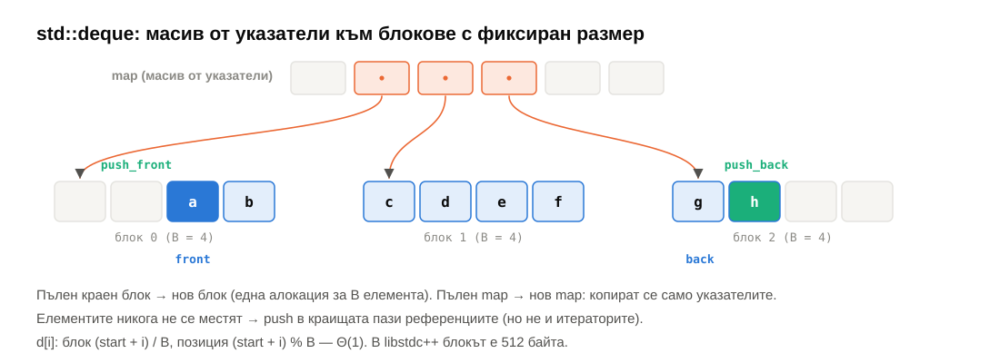

<p class="small">Нито масив, нито списък. Затова е по подразбиране под <code>std::stack</code> и <code>std::queue</code>.</p>

---

## Кръгов буфер

<div class="r-stack">
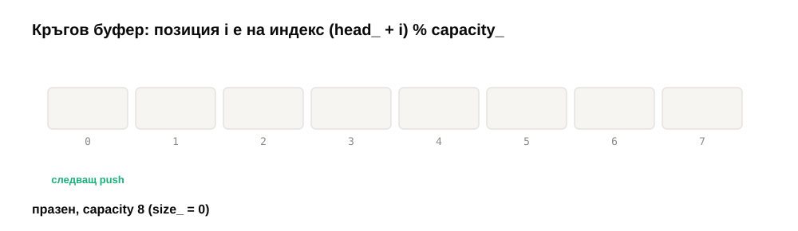
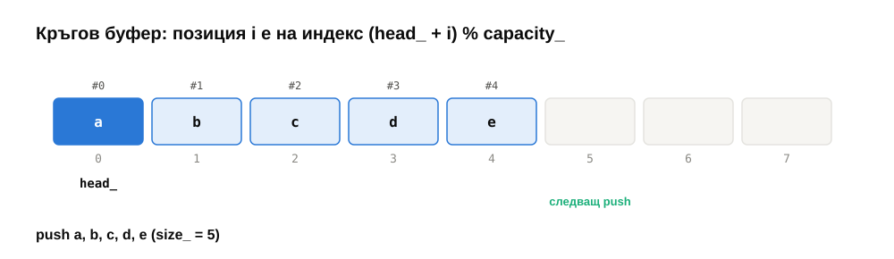
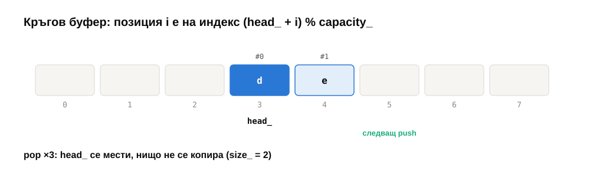
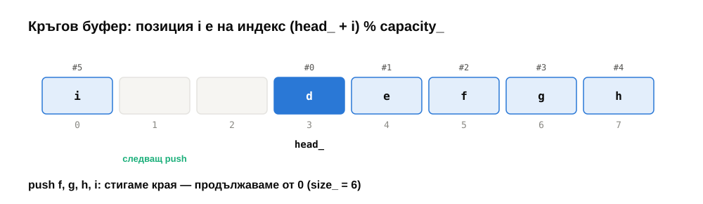
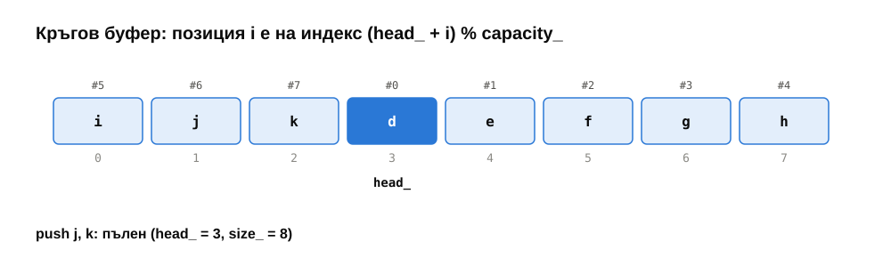
</div>

<p class="small fragment" data-fragment-index="4">Пълен: следващият <code>push</code> би писал точно на <code>head_</code>. Ако пазехме само <code>head</code> и <code>tail</code>, <code>head == tail</code> значи празен <em>или</em> пълен? <span class="fragment answer" data-fragment-index="5">затова пазим <code>size_</code> (или винаги оставяме едно място празно)</span></p>

---

## Растеж: разгъване

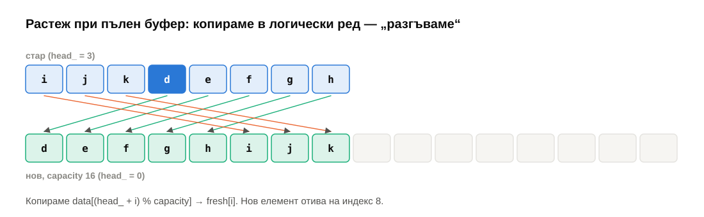

<div class="box warn fragment">

Грешно: `std::copy(data_, data_ + capacity_, fresh)` — копира във **физически** ред. Ако `head_ != 0`, опашката е разбъркана.

</div>

---

## Опашка от два стека

<div class="r-stack">
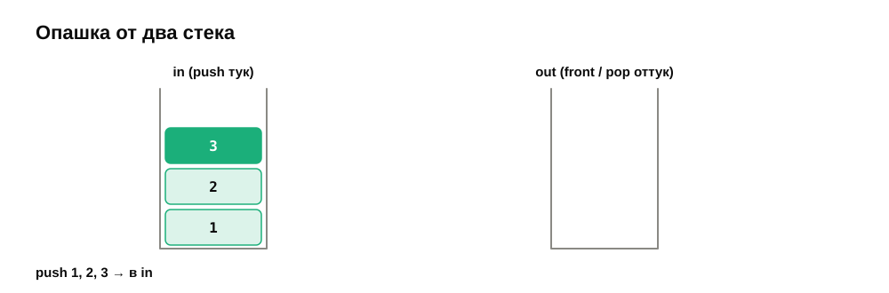
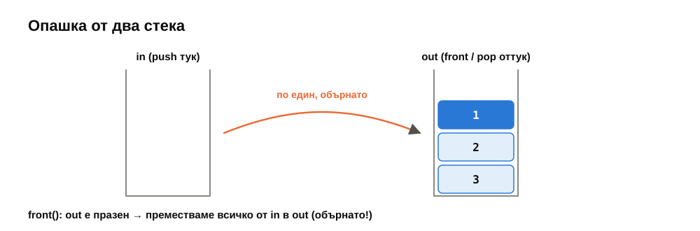
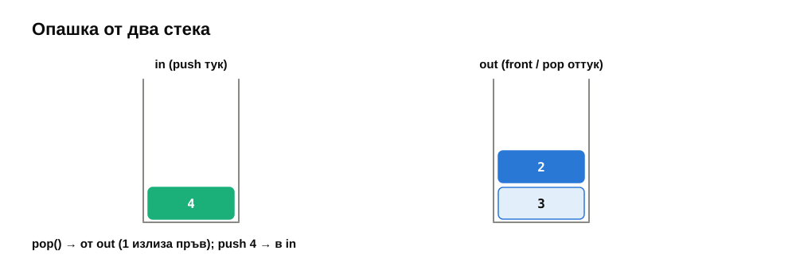
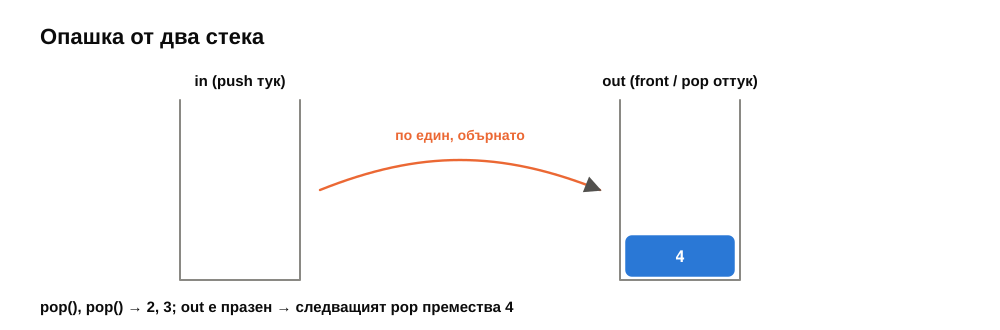
</div>

<p class="small fragment" data-fragment-index="3">Всеки елемент се прехвърля <strong>най-много веднъж</strong> → амортизирано $\Theta(1)$ (седмица 04).</p>

<p class="small fragment" data-fragment-index="4">Защо прехвърляме <strong>само</strong> когато <code>out</code> е празен? <span class="fragment answer" data-fragment-index="5">иначе новите елементи застават над по-старите в <code>out</code> и излизат преди тях</span></p>

---

## Защо `std::stack::pop()` връща `void`?

```cpp
T pop() { T top = std::move(c_.back()); c_.pop_back(); return top; }   // изглежда удобно…

w = s.pop();   // …но присвояването в w става СЛЕД pop_back
```

<div class="fragment">

Ако присвояването хвърли, елементът е вече махнат — **изгубен**. Силна гаранция няма как да се даде.

Освен това `T pop()` копира **винаги** — дори когато стойността не ви трябва.

STL разделя: `top()` (референция, не копира) и `pop()` (не връща нищо).

</div>

---

<!-- .slide: data-background-color="#dcf3ea" -->

# На живо: Proxy

<p class="small">20 минути · обект, който се преструва на референция</p>

---

## Шаблонът Proxy

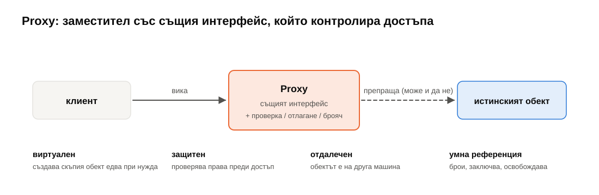

---

## Бит няма адрес

```cpp
std::vector<std::uint64_t> words_;   // 64 bool-а в една дума: 8× по-малко памет

bool& operator[](std::size_t i);     // невъзможно — няма bool в паметта
```

<div class="fragment">

```cpp
class BitRef {                       // прокси: „коя дума, кой бит“
    std::uint64_t* word_;
    std::uint64_t mask_;
public:
    operator bool() const;           // bool b = v[3];
    BitRef& operator=(bool);         // v[3] = true;
    BitRef& operator=(const BitRef&);// v[3] = v[5];   ← капан!
};
```

</div>

---

## `BitRef` отблизо

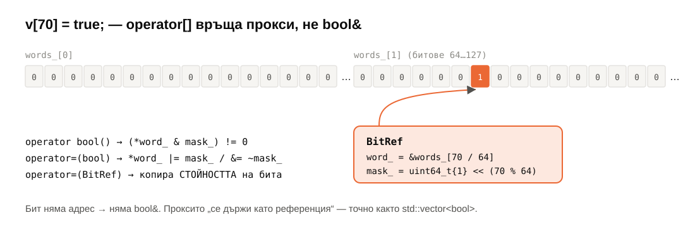

<p class="small fragment">Не <code>1 &lt;&lt; (i % 64)</code>: <code>1</code> е <code>int</code> и препълва при отместване $\ge 31$.</p>

---

## Два капана

<div class="cols">
<div>

**Генерираният `operator=`**

```cpp
v[3] = v[5];
```

копира **полетата** на проксито: временното прокси вляво започва да сочи бит 5 — и умира в края на реда. Бит 3 не се променя, компилаторът не предупреждава.

</div>
<div>

**`auto`**

```cpp
auto r = v[1];   // BitRef, не bool!
r = true;        // променя v
bool b = v[1];   // истинско копие
```

Ако `v` умре преди `r` — висящ указател. Същото е със `std::vector<bool>` — „контейнерът, който не е контейнер“.

</div>
</div>

---

## Proxy, Adapter, Decorator

| | Интерфейс | Цел | Пример |
|---|---|---|---|
| **Proxy** | същият | контролира достъпа | `BitRef`, `unique_ptr`, `shared_ptr` |
| **Adapter** | различен | преобразува | `Stack` върху `vector`, `std::queue` |
| **Decorator** | същият | добавя поведение | буфериран поток върху файл |

<p class="small">И трите обвиват друг обект — разликата е в <strong>намерението</strong>.</p>

---

<!-- .slide: data-background-color="#f6f5f2" -->

# ☕ Почивка

<p class="small"><code>git pull</code> · седмица 07 е в <code>weeks/07-proxy-stack-queue</code></p>

---

<!-- .slide: data-background-color="#fde8df" -->

# Практика <span class="timer">35 мин</span>

<p class="small">По двойки. <a href="exercises.md">exercises.md</a> · <code>ctest --preset default -R "^w07/"</code></p>

---

## Задачи 1–3 — стек и опашки

- **★ `Stack<T, Container>`** — върху `vector`, `deque`, `list`; `push(T&&)` с `unique_ptr`.
- **★★ `RingQueue<T>`** — `(head_ + i) % capacity_`; разгъване при растеж.
- **★★★ `TwoStackQueue<T>`** — тестът брои прехвърлянията: $\le$ броя `push`.

---

## Задачи 4–5

- **★★ `BitVector`** — `BitRef`: четене, запис, копиране на **стойност**, `flip`; `count()` само в използваните битове.
- **★ скоби**, **★★ стек с минимум**, **★★★ максимум в плъзгащ се прозорец** (монотонен дек).

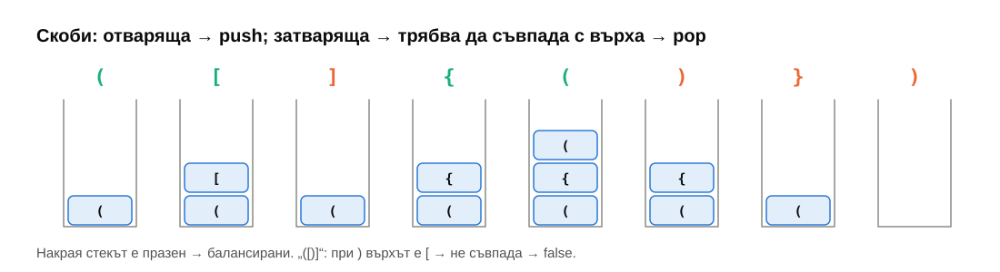

---

## Задача 5 — две идеи

<div class="cols">
<div>

**Стек с минимум**

Втори стек `mins_`: на всяка височина — минимумът на всичко под и на нея.

<div class="fragment">

- `push(x)` → `mins_.push(min(x, mins_.top()))` (или `x`, ако е празен)
- `pop()` → от двата
- всичко $\Theta(1)$, двойна памет

</div>
</div>
<div>

**Монотонен дек**

Дек от **индекси**; стойностите намаляват отпред назад.

<div class="fragment">

- нов $a_i$ маха отзад всички $\le a_i$ — те вече никога няма да са максимум
- отпред е максимумът; излиза, когато напусне прозореца
- всеки индекс влиза и излиза веднъж → $\Theta(n)$

</div>
</div>
</div>

---

## Задача 6 — една буква, 6× разлика

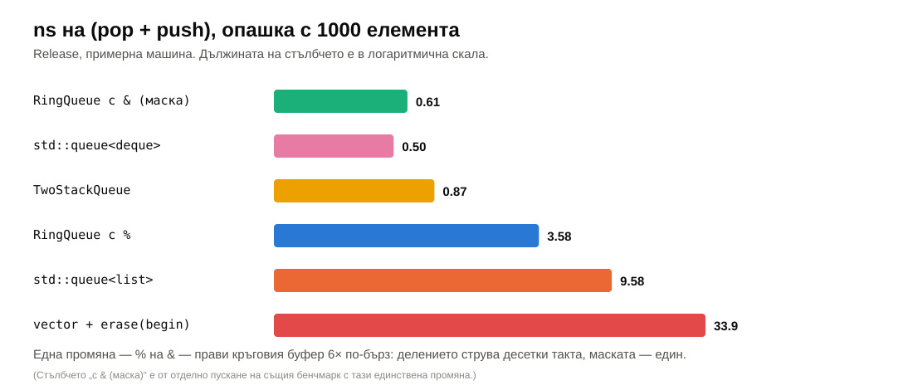

<p class="small">Капацитетът е степен на 2 → <code>x % cap == x &amp; (cap - 1)</code>. Пробвайте.</p>

---

## Обобщение

- **Proxy** — същият интерфейс, контролира достъпа; в C++: обект, върнат вместо референция.
- **Стек** — LIFO, върхът е краят на масива; **опашка** — FIFO, никога `erase(begin())`.
- **Кръгов буфер** — нищо не се мести; **два стека** — амортизирано $\Theta(1)$.
- **Дек** — блокове с фиксиран размер: $\Theta(1)$ в двата края и по индекс.
- **Адаптери** — `std::stack`, `std::queue`, `std::priority_queue`; `pop()` връща `void`.
- Асимптотиката избира алгоритъма; константите — реализацията.

---

## До следващия път

- Довършете задачи 1, 2, 4 и 5.1–5.2; 3, 5.3 и 6 — за любопитните.
- Прочетете [notes.md](notes.md) — особено §4 (дек) и §6 (приложения).
- **Контролно 1** е седмицата 23–27 ноември — по лекции 01–09, **включително дървета** (на семинар ги упражняваме чак на 3 декември). За преговор: таблиците „Обобщение“ в края на записките и [записките за дървета](../09-trees-1/notes.md).
- **Следващия четвъртък:** Shunting-yard, хеш функции и хеш таблици.

<div class="box task">

**Изходен въпрос:** как бихте пресметнали `3 + 4 * (2 - 1)` с компютър, който може само да чете символите отляво надясно — и има един стек?

</div>
